# Segmentation QC Criteria

## Overall principle

**What we are assessing is the segmentation** — whether it conforms to clinically correct cardiac structure. A segmentation that faithfully follows the true anatomy is what allows an accurate mesh to be fitted from it.

The 3D mesh is therefore a **visualization aid, not the target of the assessment**: it makes structural problems in the segmentation easier to see. Treat it as a reference — judge the **segmentation**, and use the mesh to help you spot where it goes wrong.

## Terminology & grading

- **LVepi / LVendo / LVmyo** — the LV **epi**cardium, **endo**cardium, and **myo**cardium mesh surfaces. Assess final mesh quality with *either* the **LVepi + LVendo** pair *or* the **LVmyo** surface; if either representation is acceptable, the case passes (see Notice 1).
- **Two grading bars** are used below:
  - **Strict** — judge the mesh against a normal heart on every feature and reject any notable deviation.
  - **Minimum-requirement** — accept a mesh that is usable overall, tolerating specific known artifacts (e.g. apical-thickness overestimation) by excluding them from assessment.

## Notice

> **Decisions are made per case, not per individual mesh.** A case passes if *either* representation (LVepi + LVendo, or LVmyo) is acceptable. Notice 1 illustrates this: the LVepi + LVendo mesh is rejected (thick apex), but since LVmyo is good, the **case is accepted**.

1. **When assessing the final mesh quality, you have two options: LVepi + LVendo, or LVmyo — either one passing is enough.**
 
***Recommendation: for the LVepi + LVendo mesh, REJECT (strict); for the LVmyo mesh, ACCEPT***
 
    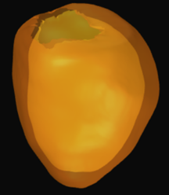{width=100}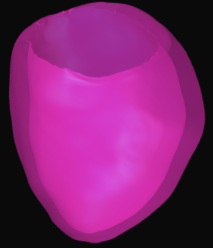{width=100}

*(In this case, LVepi + LVendo shows a thicker apex than a normal heart, while LVmyo looks good, so finally accept this case)*

2. **In some cases, if the overestimation of apical thickness is the only issue, then exclude it from assessment.**
 
***Recommendation: under the minimum-requirement standard, ACCEPT***
 
    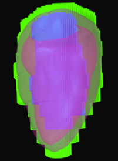{width=100}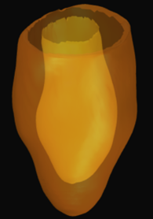{width=95}

*(In this case, due to focal basal hypertrophy, LVmyo is not realistic or suitable. For LVepi + LVendo, accept the case, excluding the thick apex from assessment)*

3. **Based on observation, LVmyo is not suitable for cases with myocardial hypertrophy, so in these cases, better use LVepi + LVendo for assessment. Also, set the segmentation opacity to 90% to easily identify myocardial hypertrophy.**
 
***Recommendation: REJECT***
 
    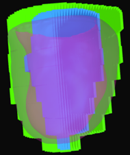{width=90}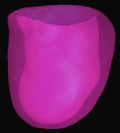{width=100}

*(In this case, due to diffuse concentric hypertrophy, LVmyo is not realistic or suitable)*

## Slice misalignment

*Set the segmentation opacity to 90% to observe the LV epicardium and endocardium.*

#### Basal endocardial misalignment

***Recommendation: REJECT***

{width=100}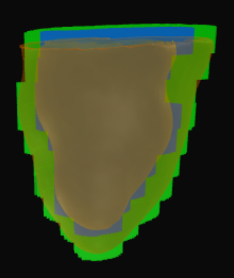{width=100}

*(In this case, no obvious misalignment is observed when assessing the epicardium only, but together with the endocardium, misalignment of the basal endocardium results in an unusual basal morphology)*

#### Focal misalignment

***Recommendation: REJECT***

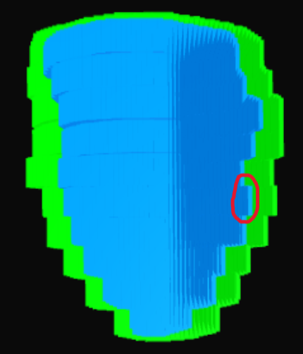{width=100}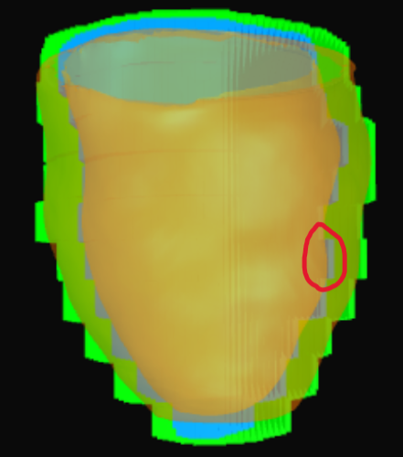{width=99}

*(In this case, mild misalignment results in focal irregularity of the cardiac morphology)*

#### Diffuse misalignment

***Recommendation: REJECT***

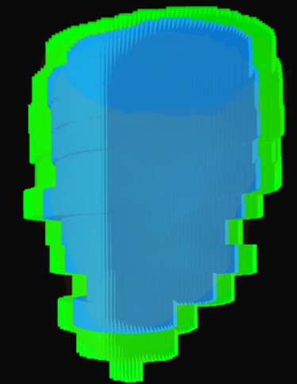{width=100}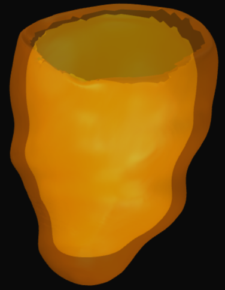{width=100}

*(Misalignment across multiple slice levels distorts the overall cardiac morphology)*

## Flat apex

- When generating the mesh, the apical endocardium is typically near the superior margin of the final slice, whereas the epicardium is generally near the inferior margin of the final slice
- There are slight differences in mesh generation depending on whether the final slice is all myocardium or contains part of the cavity
- If the final slice is relatively small, it may be ignored during mesh generation.

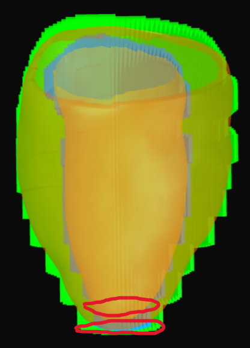{width=100}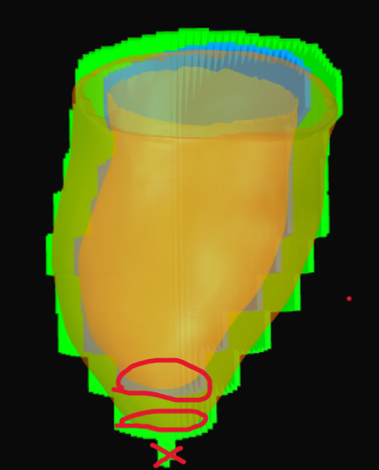{width=110}

Evaluate whether the cardiac apex is sharp based on the mesh generation pattern.

***Recommendation: ACCEPT the first mesh, REJECT the second mesh***

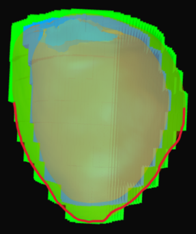{width=100}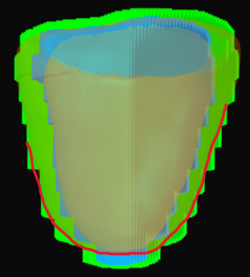{width=100}

*(Sharp apex vs. flat apex)*

## Special cases

#### Oblique short-axis plane

***Recommendation: REJECT***

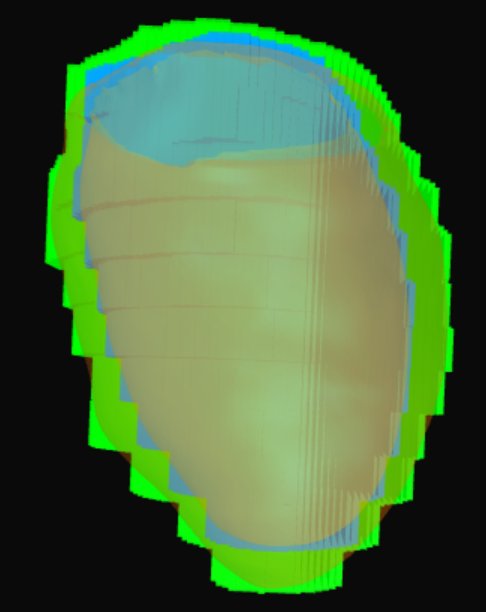{width=100}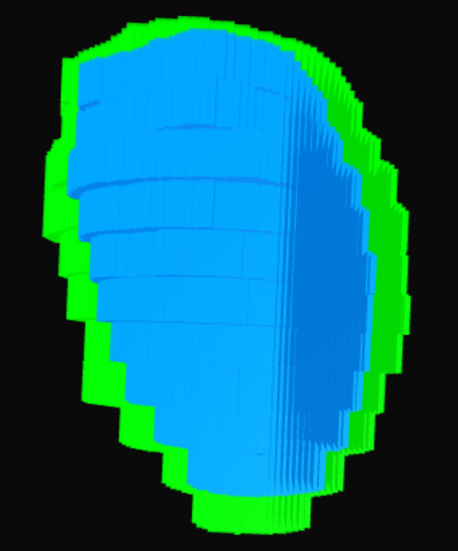{width=100}

*(When scanning, the short-axis plane was not perpendicular to the long axis, resulting in an irregular overall morphology)*

#### Global slice shift

***Recommendation: REJECT***

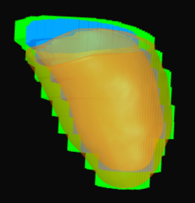{width=100}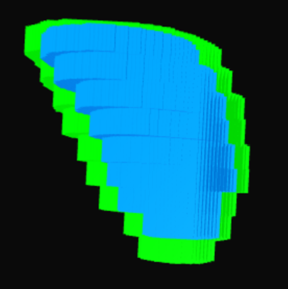{width=100}

*(All slices are displaced simultaneously toward one side)*

#### Insufficient apical repair

***Recommendation: REJECT***

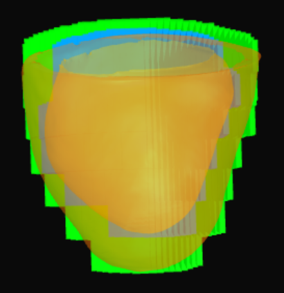{width=100}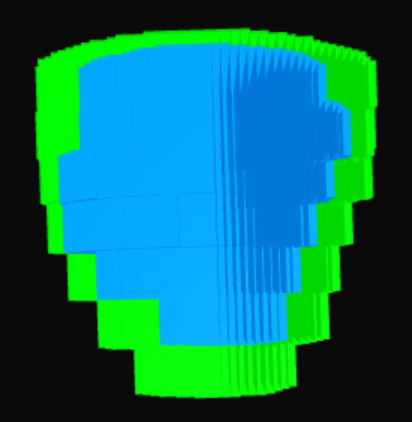{width=100}

*(Insufficient apical repair resulted in an overall shorter and smaller heart)*

## Good cases

***Recommendation: ACCEPT***

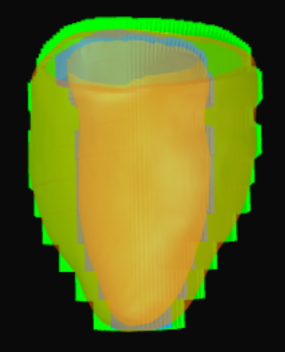{width=100}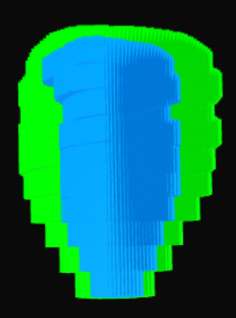{width=90}

*(Sharp apex, well-aligned slices, and realistic myocardial thickness)*

***Recommendation: ACCEPT***

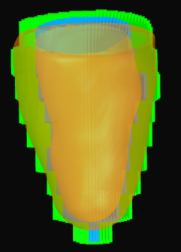{width=100}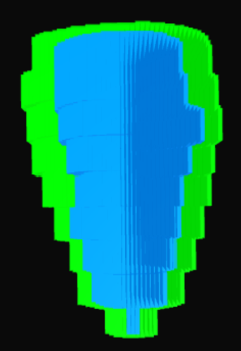{width=95}

*(Clean epicardial and endocardial contours with no misalignment)*